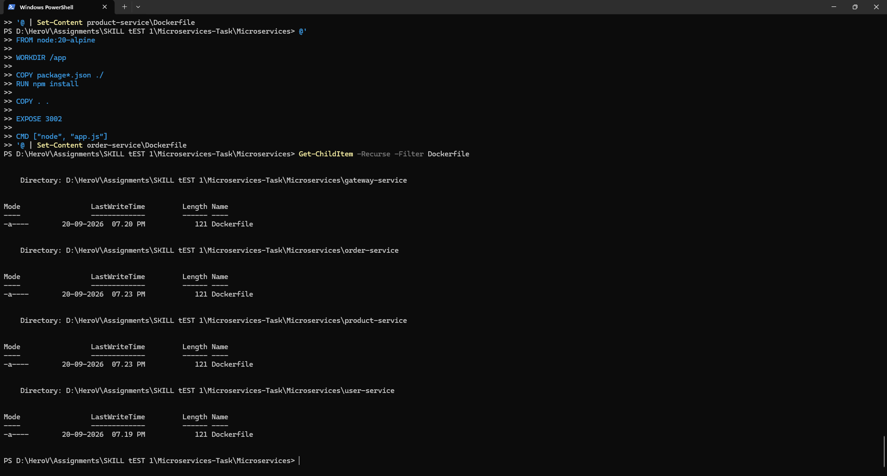
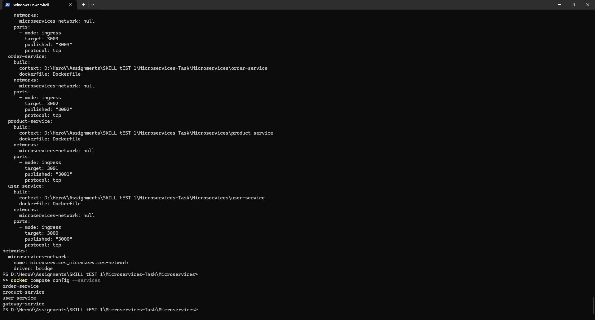
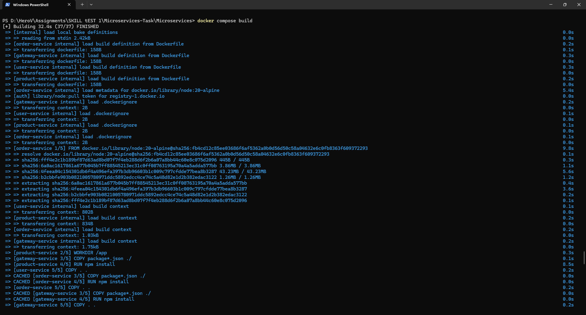
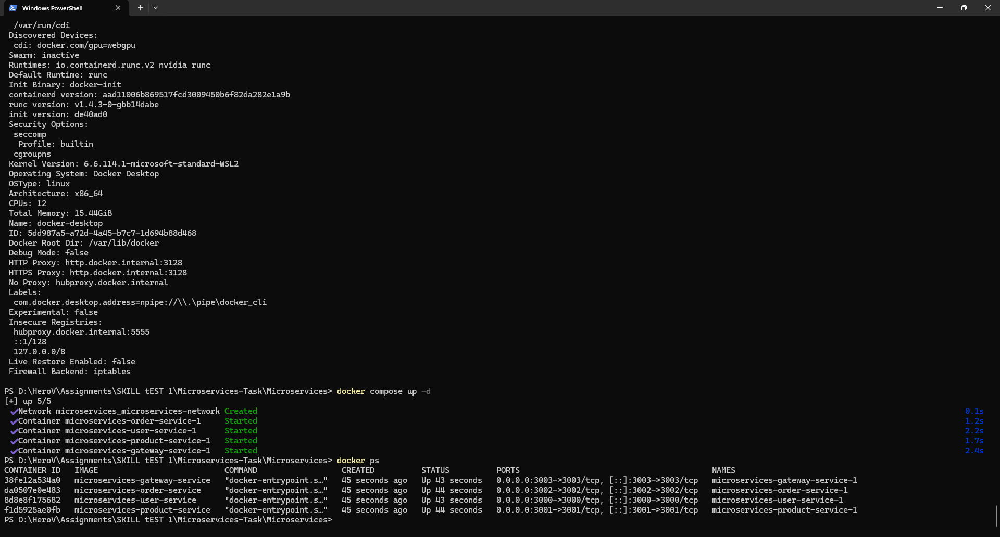
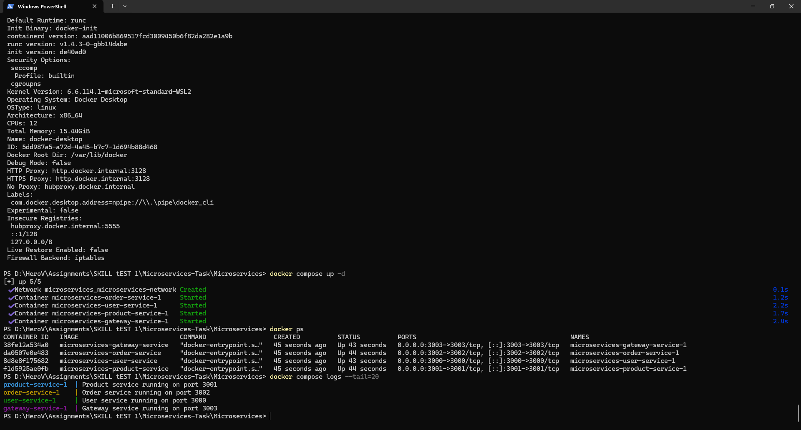
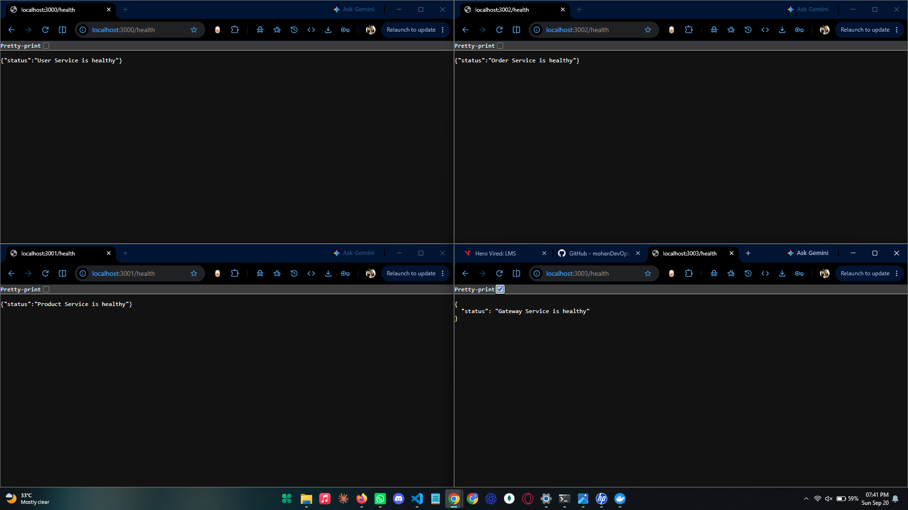
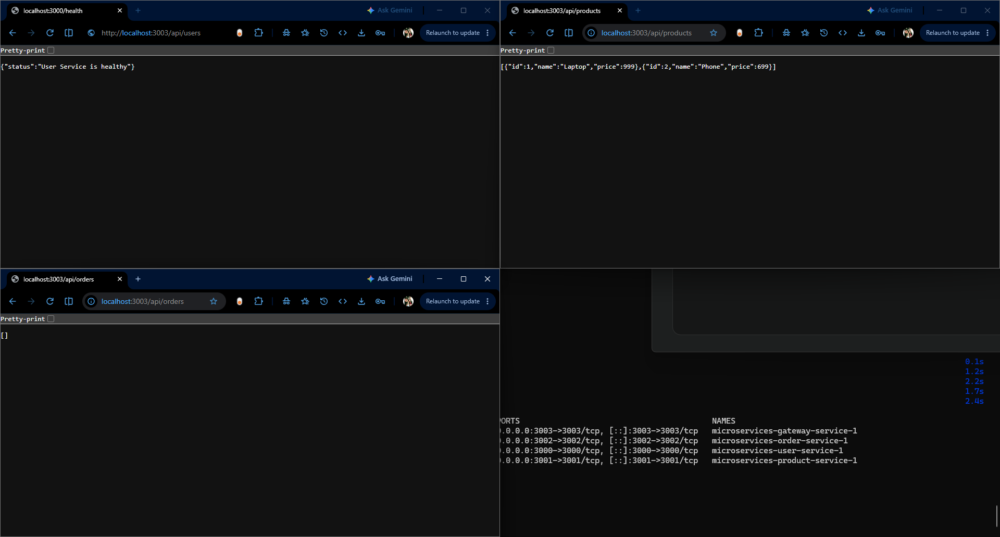
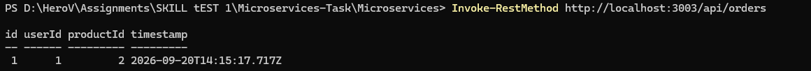

# Microservices Containerization with Docker

## Project Overview

This project demonstrates containerization and orchestration of a Node.js microservices-based application using Docker and Docker Compose.

The application consists of four services:

- **User Service** - Port 3000
- **Product Service** - Port 3001
- **Order Service** - Port 3002
- **Gateway Service** - Port 3003

The Gateway Service communicates with the other services through a shared Docker network.

## Project Structure

```text
Microservices/
├── user-service/
│   ├── app.js
│   ├── package.json
│   └── Dockerfile
├── product-service/
│   ├── app.js
│   ├── package.json
│   └── Dockerfile
├── order-service/
│   ├── app.js
│   ├── package.json
│   └── Dockerfile
├── gateway-service/
│   ├── app.js
│   ├── package.json
│   └── Dockerfile
├── docker-compose.yml
├── README.md
└── screenshots/
```

## Prerequisites

- Docker Desktop
- Docker Compose
- Git

Verify Docker:

```bash
docker --version
docker compose version
```

## Dockerfiles

Each service has its own Dockerfile. The Dockerfiles use Node.js 20 Alpine, set `/app` as the working directory, install dependencies, copy the application code, expose the appropriate port, and start the application with Node.js.

## Docker Compose

`docker-compose.yml` defines all four services and connects them to a shared Docker bridge network.

| Service | Container Port | Host Port |
|---|---:|---:|
| User Service | 3000 | 3000 |
| Product Service | 3001 | 3001 |
| Order Service | 3002 | 3002 |
| Gateway Service | 3003 | 3003 |

The Gateway communicates with the other containers using Docker service names:

```text
http://user-service:3000
http://product-service:3001
http://order-service:3002
```

## Build the Application

From the project root:

```bash
docker compose build
```

## Start the Services

```bash
docker compose up -d
```

Check running containers:

```bash
docker ps
```

## Stop the Application

```bash
docker compose down
```

## Service Endpoints

### User Service

```text
GET http://localhost:3000/health
GET http://localhost:3000/users
```

### Product Service

```text
GET http://localhost:3001/health
GET http://localhost:3001/products
```

### Order Service

```text
GET http://localhost:3002/health
GET http://localhost:3002/orders
```

### Gateway Service

```text
GET  http://localhost:3003/health
GET  http://localhost:3003/api/users
GET  http://localhost:3003/api/products
GET  http://localhost:3003/api/orders
POST http://localhost:3003/api/orders
```

## Testing

All four service health endpoints were successfully tested through localhost.

The Gateway was also tested for communication with the User, Product, and Order services over the Docker network.

An order was successfully created through the Gateway using:

```json
{
  "userId": 1,
  "productId": 2
}
```

and was subsequently retrieved through `GET /api/orders`.

## Troubleshooting

### Docker daemon is not running

If you see:

```text
failed to connect to the docker API
```

start Docker Desktop and wait for the Docker engine to become available.

Verify with:

```bash
docker info
```

### Check running containers

```bash
docker ps
docker compose ps
```

### View logs

```bash
docker compose logs
```

For an individual service:

```bash
docker compose logs user-service
docker compose logs product-service
docker compose logs order-service
docker compose logs gateway-service
```

### Rebuild after changes

```bash
docker compose down
docker compose build
docker compose up -d
```

### Gateway cannot reach another service

Container-to-container communication must use Docker Compose service names such as `user-service`, `product-service`, and `order-service`, rather than `localhost`.

## Screenshots

### 1. Four Dockerfiles



### 2. Docker Compose Configuration



### 3. Successful Docker Build



### 4. All Containers Running



### 5. Application Startup Logs



### 6. Localhost Health Checks



### 7. Gateway Communication

The screenshot below shows successful Gateway requests to the Product and Order services. The `/api/users` browser tab was also tested separately.



### 8. Order Creation and Retrieval



## Conclusion

The Node.js microservices application was successfully containerized using Docker and orchestrated using Docker Compose.

All four services build successfully, run as independent containers, communicate through a shared Docker network, and are accessible through their respective localhost ports.
